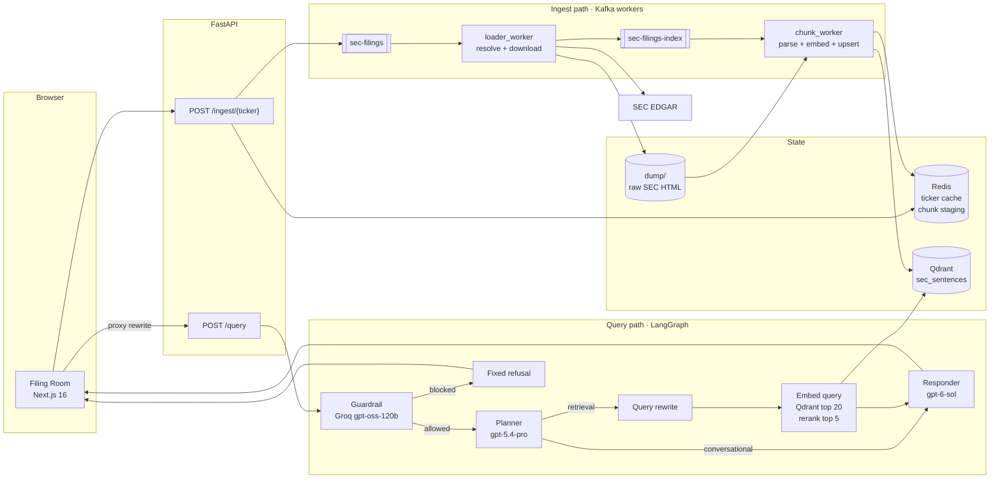

# SEC Filing RAG

The smallest useful slice is one command:

```powershell
python index_filing.py AAPL --form 10-K --dry-run
```

Run it from `backend/` after installing the Python requirements. It downloads the latest Apple 10-K, parses the HTML in document order, splits prose into sentences, and writes sentence-level records that keep their PART/Item/subsection path. It embeds them with a deterministic local embedder into an in-memory Qdrant collection, then prints a summary and five sample records. No API keys, Docker, or hosted model/vector services are involved.

The full system swaps the dry run's local pieces for Kafka, Redis, and a persistent Qdrant collection. A Next.js client sends questions to FastAPI; a LangGraph agent guards the request, decides whether retrieval is needed, rewrites the query, fetches and reranks filing sentences, and returns an answer plus source links back to the supporting text on SEC EDGAR.

## What you get

- Answers grounded in indexed 10-K, 10-Q, and 8-K filings. Retrieval answers carry numbered sources with direct SEC links.
- A guardrail before the planner. Off-topic prompts, investment advice, and prompt-injection attempts get a fixed refusal (`type: "blocked"`) instead of reaching the retrieval stack.
- Asynchronous ingestion. On a cache miss, `POST /ingest/{ticker}` returns `202` and lets workers handle download, parse, embed, and upsert.
- Sentence-level citations. Source links prefer an exact HTML anchor, fall back to a `#:~:text=` fragment, and finally to the filing URL.

## Architecture

The write path and read path are separate. Their shared state is Qdrant; the raw HTML in `dump/` lets the index stage retry without downloading the filing again.



### Ingest path

1. `POST /ingest/{ticker}` normalizes the ticker and form, then checks Redis for a cached CIK, company name, and year. On a miss it resolves the company against SEC, publishes a job to the `sec-filings` topic, and returns `202`. On a cache hit it returns `200` with `status: "cached"` and does not enqueue another job.
2. `loader_worker.py` (consumer group `loader`) resolves the filing's accession number and primary document, downloads the HTML, writes it under `dump/`, and publishes an index job to `sec-filings-index`.
3. `chunk_worker.py` (consumer group `step2`) parses each document in a process pool and writes every sentence record to Redis in document order. Saving a new parse clears the document's previous index marker.
4. The worker embeds the staged records in batches and upserts them into Qdrant. A staged batch is deleted after its Qdrant upsert succeeds.
5. Each document is marked indexed after its points are upserted. Kafka offsets are committed only after every document in the poll batch succeeds. Replays skip a document when its indexed point count is at least the stored count and the embedding model, parser version, and collection name still match.

The split is deliberate: the API does the fast part, and the slow, failure-prone parts run in workers with retries. A failed batch leaves Kafka offsets uncommitted, so the work is retried rather than lost.

### Query path

1. The browser sends `{"user prompt": "..."}` to `/api/backend/query`. Next.js rewrites that path to FastAPI and forwards `X-Conversation-Id`.
2. `run_agent` loads the conversation history for that ID and starts the LangGraph flow.
3. The guardrail calls Groq `openai/gpt-oss-120b`. A blocked prompt ends the run with a fixed refusal; the planner, retrieval service, and answer model are never called.
4. The planner calls the classifier endpoint and returns `conversational` or `retrieval`. It sees the conversation history, so a follow-up can be answered without another search.
5. For retrieval, the rewriter turns the latest message plus history into a self-contained query. The query is embedded, Qdrant returns the top 20 candidates, and the reranker cuts them to the top 5 that are actually sent to the answer model.
6. The responder receives the numbered chunks and is instructed to cite them as `[1]`, `[2]`. FastAPI maps those chunks to source records and returns the route, answer, and sources.

### Why the pieces look like this

**Sentence records, not fixed-size chunks.** `sentence_records.py` walks the DOM in order and tracks PART, Item, and subsection headings. Every record stores its `hierarchy`, `part`, `item_id`, `item_title`, `source_url`, `anchor_id`, and position in the document. The vector input is `hierarchy breadcrumb + unit text` (a sentence for prose, markdown for tables), not a raw token window. A sentence about pricing pressure is therefore embedded with the section that gives it meaning, and the citation can point at the exact sentence rather than the top of a 200-page filing.

**Tables stay tables.** Real tables become markdown records and large tables are split into row groups (40 rows per group, above 60 rows total). Layout tables and tables with one cell per row are walked as normal content instead of being flattened into meaningless pipes.

**Deterministic IDs.** `make_point_id` hashes the accession number, document ID, DOM key, sentence index, and sentence text, then wraps the hash in a UUIDv5. Qdrant stores the resulting ID. Reprocessing the same sentence produces the same point ID, so retries overwrite instead of duplicating.

**Redis is both a cache and a handoff buffer.** The ticker cache is fail-open: if Redis is unavailable, resolution still works, just uncached. Chunk staging is not optional for the worker path; it is how parsing is separated from embedding and how interrupted batches are resumed.

**The guardrail runs first.** It rejects prompts that are unrelated to SEC filings, ask for investment advice, or try to override the system. That keeps the expensive path focused and makes the refusal deterministic.

## Quickstart

### Prerequisites

- Python 3.12
- Node.js 20.9 or newer
- Docker, for Redis and Kafka
- A Qdrant instance (Qdrant Cloud or a local server)
- Service endpoints and keys for embeddings, reranking, and the Responses-style classifier/answer models
- A Groq API key for the guardrail

### 1. Start Redis and Kafka

```powershell
cd backend
docker compose up -d
```

This starts Redis on `6379` and Kafka on `9092`. Qdrant is not in the compose file; point `QDRANT_URL` at your instance.

### 2. Install the backend

```powershell
python -m venv .venv
.venv\Scripts\Activate.ps1
pip install -r requirements.txt
Copy-Item .env.example .env
```

Edit `.env` and fill in the Qdrant, model gateway, and Groq values. `.env.example` is the authoritative key list. Never commit `.env`.

### 3. Verify the parser without external services

```powershell
.venv\Scripts\python.exe index_filing.py AAPL --form 10-K --dry-run
```

This uses an in-memory Qdrant collection and a deterministic hash embedder. It still downloads the filing from SEC, so internet access is required. The summary shows record counts, vector size, embedding model, and parser version. The five sample records show the unit type and hierarchy for each record.

### 4. Run the API

```powershell
.venv\Scripts\python.exe -m uvicorn main:app --host 0.0.0.0 --port 8000 --reload
```

### 5. Run both workers

In two more terminals, from `backend/`:

```powershell
.venv\Scripts\python.exe loader_worker.py
```

```powershell
.venv\Scripts\python.exe chunk_worker.py
```

The loader consumes `sec-filings`; the chunk worker consumes `sec-filings-index`. Keep both running while you ingest.

### 6. Run the frontend

```powershell
cd ..\frontend
npm install
npm run dev
```

Open `http://localhost:3000`. The Next rewrite defaults to `http://127.0.0.1:8000`; set `BACKEND_URL` before starting Next if the API lives elsewhere.

### 7. Index a filing

Use the **Index filing** button in the UI, or call the endpoint:

```powershell
curl.exe -X POST "http://localhost:8000/ingest/AAPL?form_type=10-K&report_year=2025"
```

You can also bypass Kafka and write directly to Qdrant with the CLI:

```powershell
.venv\Scripts\python.exe index_filing.py AAPL --form 10-K --report-year 2025
```

The CLI path is useful for a single controlled ingest. The API path is the one that exercises the background pipeline.

## API

| Endpoint | What it does |
| --- | --- |
| `GET /` | Returns the service name and a link to `/docs`. |
| `POST /query` | Routes a prompt through the agent and returns `{type, answer, sources}`. |
| `POST /ingest/{ticker}` | Resolves a ticker and queues a download job on a cache miss. Query parameters: `form_type`, `report_year`, `filing_year`. |
| `GET /sec/filing` | Resolves, downloads, extracts, and dumps one filing synchronously. Useful for inspection, not for indexing. |
| `GET /health` | Reports which `.env` keys loaded, with masked previews. Treat it as an internal diagnostic. |

`/query` accepts an optional `X-Conversation-Id` header. Use the same ID across turns to keep server-side context.

The response `type` is one of:

- `conversational`: answered from history or general conversation; `sources` is empty.
- `retrieval`: answered from filing context; `sources` lists the retrieved chunks with citation numbers.
- `blocked`: the guardrail refused the prompt; the answer is the fixed refusal.

Each source has a `citation` number that matches the numbered context given to the answer model. `link_type` is one of:

| `link_type` | Where the link goes |
| --- | --- |
| `anchor` | An exact HTML anchor in the SEC filing, when the record has an `anchor_id` or `source_dom_id`. |
| `text_fragment` | A `#:~:text=` URL built from the retrieved text or the last section heading, used when no anchor exists. |
| `document` | The filing URL without a fragment. |

## Configuration

`.env.example` is the full list. The groups that matter most:

| Variables | Purpose |
| --- | --- |
| `QDRANT_URL`, `QDRANT_API_KEY`, `QDRANT_API`, `QDRANT_COLLECTION` | Vector store connection and collection. Default collection: `sec_sentences`. |
| `EMBED_URL`, `OPENAI_EMBEDDINGS`, `EMBED_MODEL` | Embedding endpoint and model. Default: `text-embedding-3-large`. |
| `CLASSIFIER_URL`, `CLASSIFIER_NAME`, `CLASSIFIER_KEY` | Planner and query-rewrite model. Default model: `gpt-5.4-pro`. |
| `SOL_URL`, `OPENAI_SOL` | Answer model endpoint and key. Default model: `gpt-6-sol`. |
| `RERANK_URL`, `RERANK_KEY`, `RERANK_MODEL` | Cohere-style rerank endpoint. |
| `GROQ` or `GROQ_API_KEY`, `GROQ_URL`, `GROQ_GUARDRAIL_MODEL` | Guardrail model. Default: `openai/gpt-oss-120b`. |
| `REDIS_URL`, `REDIS_TTL_SECONDS` | Ticker cache and chunk staging. |
| `KAFKA_BOOTSTRAP_SERVERS`, `KAFKA_TOPIC`, `KAFKA_STEP2_TOPIC` | Kafka connection and the two topics. |
| `CHUNK_PROCESSES`, `CHUNK_EMBED_BATCH_SIZE`, `CHUNK_UPLOAD_BATCH_SIZE` | Parser concurrency and embedding/upsert batch sizes. |
| `BACKEND_URL` | Frontend-only rewrite target. Not read by FastAPI. |

The ticker cache is fail-open. The chunk worker's Redis dependency is not; it needs Redis for staging and index markers.

## Project layout

```text
.
├── backend/
│   ├── main.py                 FastAPI routes and request/response models
│   ├── retrieval_agent.py      LangGraph guardrail, planner, rewrite, retrieval, responder
│   ├── retrieval_service.py    query embedding, Qdrant search, reranking, source formatting
│   ├── input_guardrail.py      SEC-domain gate and fixed refusal
│   ├── loader_worker.py        Kafka stage 1: resolve, download, dump
│   ├── chunk_worker.py         Kafka stage 2: parse, embed, upsert
│   ├── sentence_records.py     structure-aware sentence parser
│   ├── sentence_splitter.py    abbreviation-aware sentence segmentation
│   ├── ingest_pipeline.py      parse -> embed -> Qdrant, plus ingest summary
│   ├── qdrant_store.py         collection management, point IDs, search, upsert
│   ├── embeddings.py           sync and async embedding clients
│   ├── chunk_store.py          Redis chunk staging and index markers
│   ├── job_queue.py            Kafka producer and topic names
│   ├── sec_pipeline.py         SEC resolve, download, extract, dump
│   ├── document_extractor.py   HTML/PDF text extraction
│   ├── sec_client.py           SEC HTTP client and URL helpers
│   ├── filing_resolver.py      filing selection and ticker normalization
│   ├── async_sec.py            async SEC client and resolution
│   ├── terminal_ui.py          loader download progress
│   ├── cache.py                fail-open Redis JSON cache
│   ├── index_filing.py         single-filing CLI
│   ├── docker-compose.yml      Redis and Kafka
│   ├── .env.example            configuration template
│   └── tests/                  parser, resolver, worker, storage, and retrieval tests
└── frontend/
    ├── next.config.ts          backend rewrite and proxy timeout
    └── src/
        ├── app/page.tsx        chat shell and request lifecycle
        ├── components/         message list, source cards, composer, sidebar, ingest dialog
        └── lib/                API client, types, chat store, backend status
```

## Tests

Backend tests run from the repository root:

```powershell
backend\.venv\Scripts\python.exe -m pytest
```

`pytest.ini` points at `backend/tests`. The suite covers sentence splitting, structure records, SEC downloads and document extraction, ticker and filing resolution, the loader, the Qdrant pipeline, cache behavior, terminal output, and retrieval source links.

Frontend checks:

```powershell
cd frontend
npm run lint
npx tsc --noEmit
npm run build
```

## Operational notes and limits

- Ingestion is eventually consistent. `/ingest` returns before the workers finish, and there is no job-status endpoint. Watch the loader and chunk worker logs, or query Qdrant directly, if you need to confirm completion.
- A cached ticker short-circuits `/ingest` with `200 cached` and does not enqueue a new job. For a deliberate re-index, use `index_filing.py` or remove the ticker cache entry.
- In local testing, a retrieval query took roughly 30–50 seconds because it makes an embedding call, a Qdrant search, a rerank call, and an answer call. The frontend allows 180 seconds, and the Next rewrite proxy allows 240 seconds. The `experimental.proxyTimeout` setting in `frontend/next.config.ts` exists for that reason. A shorter proxy timeout produces a misleading Next.js `500` even when FastAPI is still working.
- Conversation history is held in the FastAPI process, keyed by `X-Conversation-Id`. Restarting the API clears that history. The browser transcript stays in localStorage, but the agent's server-side context does not. Run one API process, or move history to shared storage before scaling out.
- Redis is optional for ticker resolution and required for the worker's chunk staging. Kafka, Redis, Qdrant, and the model endpoints are all external dependencies; the compose file only provides the first two.
- The API has no authentication or rate limiting. Add both before exposing it outside a trusted network. `.env` values stay server-side; the browser only talks to the Next rewrite.
- `dump/` holds raw SEC filings and is ignored by git. Delete entries to reclaim disk space; reprocessing requires the file or a fresh download.

## Security

Provider keys live in `backend/.env`. They are not bundled into the frontend and are not exposed through `/query`. Do not commit `.env`, and do not put real keys in `.env.example`.

`GET /health` intentionally reports key names and masked previews so a local setup can be diagnosed. Restrict or remove it if the API is reachable by untrusted clients.
